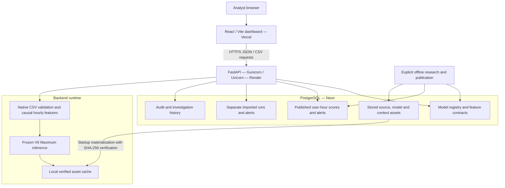
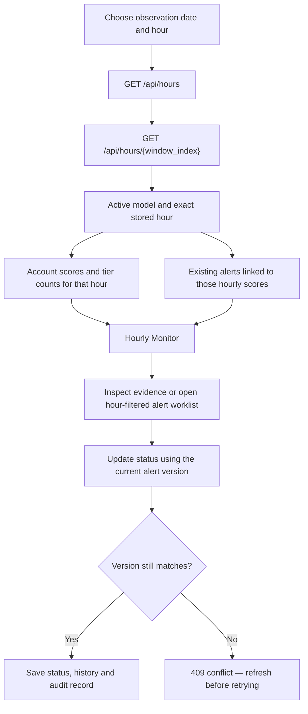
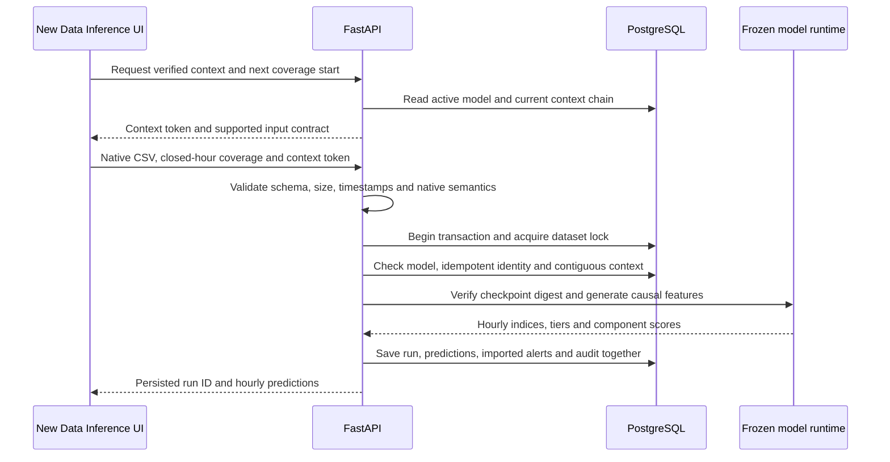
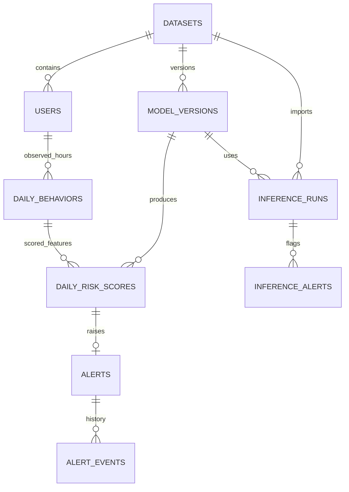

# Tracely AI

**Review user activity by hour, flag unusual behavior, and track investigations with versioned machine-learning inference.**

Tracely AI combines a React dashboard, FastAPI backend and PostgreSQL storage around the SPEDIA activity dataset. Its main model is **V6 Maximum**, a frozen ensemble of Isolation Forest and a neural autoencoder using **55 numerical features**.

[Open dashboard](https://tracely-ai.vercel.app/) · [Hourly Monitor](https://tracely-ai.vercel.app/?page=hourly) · [Main model report](https://tracely-ai.vercel.app/?page=reports)

> **Evaluation scope:** The main model's 91.16% F1 is measured on reused development validation, not an independent test. Source-origin confounding remains. Risk indices indicate unusual behavior; they are not probabilities of malicious activity.

[Architecture](#high-level-design) · [Data flows](#data-flow-source-to-published-hourly-output) · [Main model](#main-model-and-measured-result) · [Local setup](#run-locally) · [API](#api-map) · [Verification](#verification)

## What the application does

- **Hourly Monitor:** Select a date and stored hour to see its account scores, risk breakdown, event counts and matching alerts.
- **Alert investigations:** Inspect evidence and update an existing hourly alert to OPEN, IN_PROGRESS or RESOLVED, with version checks and audit history.
- **Historical analysis:** Review population trends, account dossiers and observed user-host relationships.
- **Replay:** Run the frozen model over verified historical inputs and check predictions against published scores.
- **New-data inference:** Score compatible, unlabeled native CSV events against verified prior context without fitting a model.
- **Model governance:** Display the selected model, feature contract, calibration, evaluation scope and versioned results. The original V2 model is retained for rollback.

This repository publishes the **SPEDIA application**. Raw datasets, private environment files, model binaries, runtime caches and unrelated CERT/LANL implementations are excluded.

## High-level design

The online application has three main deployment components: frontend, API and PostgreSQL. Feature generation and model scoring are Python modules inside the backend, not separate network services. Training and publication are explicit offline operations.



| Layer | Implementation | Responsibility |
|---|---|---|
| Frontend | React, Vite, Recharts, Lucide; Three.js for graph views | Hour selection, visualizations, evidence review and investigation controls |
| API | FastAPI, Gunicorn, Uvicorn | Request validation, queries, inference orchestration and status updates |
| Features | pandas and NumPy | Closed user-hour aggregation and strictly earlier behavioral context |
| Models | scikit-learn | Frozen Isolation Forest and neural reconstruction scores |
| Persistence | PostgreSQL, SQLAlchemy and Alembic | Versioned features, scores, alerts, imports, model metadata and audit records |
| Assets | PostgreSQL BYTEA plus a verified filesystem cache | Durable source/model/context bytes for Parquet and joblib readers |

**Access model:** Authentication is currently removed at the owner's request. Enabled API reads and writes are public, and audit actions use actor `public`. Confidential deployments need an external access boundary or restored authorization. See the [security review](docs/SECURITY_REVIEW.md).

## Data flow: source to published hourly output

One scored observation is **one account in one non-overlapping, completed hour**. It is not an individual event or a permanent classification of the account.

```mermaid
flowchart LR
    Source["Native SPEDIA events"] --> Prepare["Validate, normalize and apply declared curation"]
    Prepare --> Context["Current-hour activity plus earlier user history"]
    Context --> Matrix["Ordered 55-feature user-hour vectors"]
    Matrix --> Score["Score with frozen V6 components"]
    Frozen["Verified fitted models, scalers and references"] --> Score
    Score --> Fuse["Maximum of IF and neural percentile indices"]
    Fuse --> Tiers["Risk index and hourly tier"]
    Tiers --> Publish["Explicit transactional publication"]
    Publish --> Scores["Versioned hourly score records"]
    Publish --> Alerts["HIGH / CRITICAL hourly alerts"]
    Scores --> API["Read APIs"]
    Alerts --> API
    API --> UI["Dashboard and Hourly Monitor"]
```



The feature vector combines the original 30 activity/history features with 25 behavioral features, including burst concentration, activity-mix changes, personal-volume deviations, transition novelty and unusual personal activity hours. Identifiers, source-marker text and attack annotations are excluded from numerical predictors. Annotations are used separately for research selection and evaluation.

Earlier context supports novelty and personal comparisons; features do not look into future hours. Inactive or missing hours are not filled with fabricated normal observations. Source timestamps retain their supplied wall-clock basis because a timezone is not provided.

Publication stores immutable versioned scores and their matching alerts. Request handling never starts training. The V6 publication packages already fitted experimental components; it does not refit them.

## Data flow: hourly review and investigations



**Hourly risk and historical peaks are different views.** The existing Overview and user badges summarize each account's highest observed score over the displayed period. The Hourly Monitor instead shows that account's score in the selected hour. An account can therefore be LOW in one hour while its historical peak is CRITICAL.

The monitor shows all 24 hour slots for a selected date. Unobserved slots are disabled and labeled **No data**. Previous/next controls move between observed hours. **Follow latest stored hour** polls every 30 seconds; browsing an older hour turns following off. Existing alert IDs and statuses are reused rather than generating duplicate alerts when the page refreshes.

This is review of stored observations, not a continuous telemetry collector, scheduled scoring service or browser push-notification system. [Hourly Monitor guide](docs/HOURLY_MONITOR.md).

## Data flow: new CSV inference

Imported activity uses a separate, contiguous context stream and separate persistence. It does not silently change the historical benchmark or its evaluation metrics.



The CSV file is limited to **256 KiB and 1,000 events**; declared coverage must contain **1–24 complete aligned hours**. A **320 KiB request-body limit** applies before multipart parsing. Uploads must match the supported SPEDIA activity vocabulary and native units, omit annotation columns, and use verified recent history. The API rejects stale context, gaps and overlaps.

Published historical results appear in Hourly Monitor. Imported predictions and investigations remain in **New Data Inference**, matching the existing storage design.

## Core persistence design

Legacy table names contain “daily,” but the SPEDIA contract stores **hourly** ordinals and observations. Dataset accounts in `users` are source identities, not login accounts.



The diagram shows the central foreign-key relationships, not every table. `replay_runs` stores reproducible replay results, `relationships` stores observed user-host links, `audit_logs` records actions, and `stored_assets` holds durable bytes with integrity metadata. Imported raw event values are retained in inference-run JSONB; historical source events are stored as assets rather than a universal SQL event table.

## Main model and measured result

- **Active version:** `spedia-v6-maximum-20261102`
- **Configuration:** `behavior_55_if_ae_max`
- **Decision:** maximum of independently calibrated Isolation Forest and autoencoder indices
- **HIGH cutoff:** `97.72727272727273` on a 0–100 anomaly-index scale

| Metric | Reused development validation |
|---|---:|
| Precision | **95.71%** |
| Recall | **87.01%** |
| F1 | **91.16%** |
| False-positive rate | **1.18%** |
| Average precision | 0.96694 |
| ROC-AUC | 0.98717 |
| Evaluated observations | 332 user-hours: 77 positive, 255 normal |
| Confusion matrix | TN 252 · FP 3 · FN 10 · TP 67 |

The operating cutoff comes from the saved 50-per-1,000-normal-calibration-hour budget. That budget is not a guarantee of future false-alert workload. V6 uses 512 normal fitting hours, 110 later normal early-stopping hours and 110 further normal calibration hours, all from the original training partition.

**What these results establish:** the frozen candidate reproduces its saved development result. They do not establish independent or real-world attack detection. Source markers perfectly track the source dataset's event labels, and numerical features remain source-predictive. Independent normal and attack examples collected through the same verified process are still needed.

All 1,546 historical user-hours were rescored for application use. Those operational outputs are not a new untouched test. The original V2 model and its historical results remain stored for rollback. [V6 model and publication details](docs/V6_MAIN_MODEL.md).

## Run locally

### Prerequisites

- Python **3.11**; the Render configuration pins **3.11.11**.
- Node.js **22.12+** and npm for the checked-in frontend toolchain.
- A configured PostgreSQL database with the required migrations and provisioned serving assets.

A source checkout alone does not include the private data or checkpoint needed to populate the dashboard. Use an already provisioned database/asset store or restore reviewed assets through the documented process.

On a **fresh checkout**:

```bash
python3.11 -m venv .venv
.venv/bin/python -m pip install -r requirements.txt
npm --prefix frontend ci
cp .env.example .env
cp .env.example .env.spedia.local
```

Set the real `DATABASE_URL` privately in `.env` and adjust local settings in `.env.spedia.local`. Keep existing profiles if your installation is already configured. Then run:

```bash
bash scripts/run_local_neon.sh
```

Open **http://127.0.0.1:8000**. The backend listens on **http://127.0.0.1:5000** by default. The launcher checks PostgreSQL connectivity, applies pending migrations, verifies/materializes stored assets and starts Gunicorn plus Vite. It does not train or generate replacement datasets.

To run the processes separately in an **already configured shell**:

```bash
.venv/bin/python -m uvicorn src.api.app:app --host 127.0.0.1 --port 5000
```

```bash
npm --prefix frontend run dev
```

The application reads exported environment variables; it does not implicitly load `.env`. Use the configured launcher or export the intended settings first. No session secret or OIDC configuration is required by the current public application.

## Deployment and configuration

| Setting | Purpose |
|---|---|
| `DATABASE_URL` | PostgreSQL connection string, supplied privately |
| `DATASET_ID` | Active dataset scope; `spedia-v2` |
| `FRONTEND_URL` | Exact allowed frontend origin, without a trailing slash |
| `VITE_API_URL` | Backend origin at frontend build time, without `/api`; rebuilding is required after changes |
| `ASSET_STORAGE=postgres` | Resolve trusted serving assets through the PostgreSQL-backed cache |
| `ASSET_CACHE_ROOT` | Cache location; commonly `data/runtime/neon-assets` |
| `APP_ENV` | Runtime environment; production does not enable API documentation by default |

For a PostgreSQL-backed Render installation, materialize assets before starting the API:

```bash
python -m scripts.sync_neon_assets materialize --root . --cache data/runtime/neon-assets && gunicorn src.api.app:app --worker-class uvicorn.workers.UvicornWorker --workers 1 --bind 0.0.0.0:$PORT --timeout 120
```

The frontend can run on Vercel with `VITE_API_URL=https://tracely-ai.onrender.com`. The backend must allow `FRONTEND_URL=https://tracely-ai.vercel.app`. The local Vite server instead proxies same-origin `/api` requests to port 5000 by default.

`GET /health/live` checks the running process. `GET /health/ready` also checks database access, an eligible active model, published scores and the model artifact. A healthy process alone does not prove that the dashboard has usable data. [Deployment guide](docs/PUBLIC_DEPLOYMENT.md).

## API map

| Workflow | Endpoints |
|---|---|
| Overview and trends | `GET /api/stats`, `GET /api/timeline` |
| Hourly review | `GET /api/hours`, `GET /api/hours/{window_index}` |
| Investigations | `GET /api/threats?hour=…`, `POST /api/threats/{alert_id}/status` |
| Account evidence | `GET /api/users`, `GET /api/users/{user_id}` |
| Main model report | `GET /api/model-metrics`, `GET /api/model-versions` |
| Historical replay | `GET /api/replay`, `POST /api/replay/detect` |
| New-data inference | `GET /api/inference/context`, `POST /api/inference/import` |
| Scoped exports | `GET /api/export?kind=alerts&hour=…` |

Interactive API documentation is available at `/docs` in development, or when explicitly enabled. Runtime `/api/retrain` remains disabled under the frozen-model policy.

## Repository guide

```text
frontend/src/
  pages/HourlyMonitor.jsx       Date/hour selection, account risk and hourly alerts
  pages/Threats.jsx             Existing investigation worklist and status controls
  pages/Reports.jsx             Main model metrics and evaluation scope
  hooks/useApi.js               API requests and polling
src/
  api/                          FastAPI application, routes and request limits
  data/                         Native adapters, feature contracts and integrity checks
  models/v6_maximum.py          Inference-only V6 serving adapter
  inference/                    Verified model loading and context-linked raw inference
  db/                           ORM entities, publication and replay persistence
  evaluation/                   Explicit offline research and evaluation utilities
scripts/                        Local launchers, asset provisioning and model publication
migrations/                     Alembic schema revisions
tests/                          API, integrity, model and feature regression checks
docs/                           Workflow, deployment and security documentation
```

## Verification

```bash
.venv/bin/python -m pytest tests -q
npm --prefix frontend run lint
npm --prefix frontend run build
```

The latest hourly-addition publication check recorded **50 passed and 20 skipped** in the SPEDIA-only checkout. Private-artifact and isolated-PostgreSQL checks skip when their prerequisites are absent. Integration databases must use a dedicated `tracely_test*` database; do not point tests at a deployed database.

The live hourly view was also checked in Chrome for exact-hour alert navigation, a no-alert hour, mobile overflow and JavaScript errors. The existing large-bundle build warning remains. Security review findings and the retained scikit-learn compatibility exception are documented separately; a successful build is not a security guarantee.

## Further reading

- [Hourly Monitor and alert scoping](docs/HOURLY_MONITOR.md)
- [V6 main model, calibration and rollback](docs/V6_MAIN_MODEL.md)
- [Public deployment configuration](docs/PUBLIC_DEPLOYMENT.md)
- [Security checks and remaining risks](docs/SECURITY_REVIEW.md)

Built by **Gaurav Kumar**.
